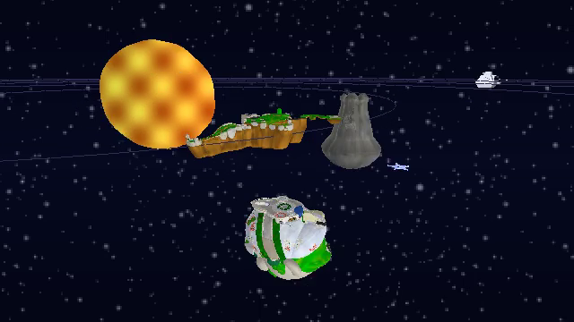

# Space Travel — Galaxy Tour

Simulación explorable de un sistema solar inspirado en los pequeños mundos de **Super Mario Galaxy**. Cinco planetas giran sobre su eje y orbitan un sol en el plano eclíptico. La **Starship Mario** permite volar entre ellos, acercarse sin cambiar de escena y usar anillos estelares para observar su superficie. Es una demostración gráfica: no hay vidas, daño ni objetivos de juego.

[](media/galaxy-tour.mp4)

**[Ver el video de demostración (MP4, 25 s)](media/galaxy-tour.mp4).** Muestra vuelo, acercamiento, vuelta alrededor, vista de superficie y alejamiento en cada planeta. El recorrido se generó con la opción `--render-video` del mismo renderer.

## Ejecutar

Se necesita Rust estable y las dependencias nativas de raylib en Linux. Los modelos convertidos necesarios ya están en `assets/processed/`.

```bash
cargo run --release
```

La ventana inicia cerca de Yoshi Star. En equipos lentos, reducir `W` y `H` en `src/renderer.rs` baja el trabajo de rasterización. La ventana escala el framebuffer interno de 640 × 360.

## Controles

| Tecla | Vuelo espacial | Cerca de la superficie |
| --- | --- | --- |
| `W` / `S` | Acelerar / retroceder | Caminar adelante / atrás sobre la malla |
| `A` / `D` | Desplazamiento lateral | Caminar lateralmente sobre la malla |
| `←` / `→` | Girar la nave | Girar la vista |
| `Espacio` / `Ctrl izquierdo` | Subir / bajar | — |
| `Shift izquierdo` | Impulso rápido | — |
| `C` | Alternar cámara cercana/lejana y nave grande/mini | — |
| `1`–`5` | Viajar cerca de un planeta | Volver al vuelo cerca del planeta elegido |
| `E` | Usar el anillo estelar cuando esté cerca | — |
| `R` | — | Invocar un anillo y regresar a la nave |
| `Esc` | Salir | Salir |

`1`–`5` seleccionan Yoshi Star, Fluffy Bluff, Freezeflame Ice, Volcano Sandwich y Throwback Fortress. El anillo está en el lado positivo del eje X de cada planeta; tras viajar con un número, la nave aparece lo bastante cerca para usar `E`. Durante el regreso, el anillo invocado aparece antes de transportar la cámara a la nave. Las órbitas siguen avanzando en todo momento.

## Planetas

| Planeta | Identidad visual | Material y fondo |
| --- | --- | --- |
| Yoshi Star | Jardín con arbustos, flores y tuberías | Césped y cielo galáctico |
| Fluffy Bluff | Islas, fuentes y relieve original | Efecto acuático y nubes |
| Freezeflame Ice | Montañas heladas y estructuras | Brillo de hielo y aurora |
| Volcano Sandwich | Relieve volcánico y géiseres | Lava animada y cielo rojizo |
| Throwback Fortress | Fortaleza, bloques y cajas | Reflejos metálicos y cielo del observatorio |

Los planetas se dibujan **solo con sus modelos originales**, sin esferas añadidas. Fluffy Bluff y las versiones mini de Fluffy Bluff y Throwback Fortress tienen una corrección de orientación al importar. Los objetos pequeños se distribuyen de forma determinista sobre triángulos de esas mallas y se orientan según la normal local. La posición de la distribución gira con cada planeta.

## Implementación

- `src/renderer.rs`: transformación de vértices, cámara, proyección en perspectiva, rasterización de triángulos, interpolación de color con corrección de perspectiva, z-buffer y shaders de fragmento en CPU. Raylib solo abre la ventana, recibe teclas, presenta el framebuffer y dibuja el HUD 2D.
- `src/math.rs`: vectores y operaciones geométricas.
- `src/asset.rs`: lector del formato de malla compacto y geometría procedural del sol.
- `src/scene.rs`: parámetros de órbita y rotación, selección de piso y búsqueda del punto más cercano sobre los triángulos del modelo.
- `src/controls.rs`: aceleración dependiente de `dt`, giro, desplazamiento, viajes rápidos y movimiento sobre el piso real de cada planeta.
- `src/main.rs`: composición de la escena, fondos por planeta, niveles de detalle y generación del video.
- `tools/convert_assets.py`: conversión opcional de los ZIP originales DAE/PNG a las mallas y cielos ya incluidos. Requiere Python, Pillow y lxml; los ZIP originales proporcionados para el proyecto deben estar en `assets/` para volver a ejecutar la conversión.

Cada planeta mantiene su tamaño fijo: sus radios visuales están entre 10 y 13 unidades y sus órbitas entre 55 y 298 unidades. Se ve mayor al acercarse **solo por perspectiva**. El renderizador elige las versiones mini de cuatro planetas cuando están lejos; Volcano Sandwich reutiliza su malla. La cámara lejana usa la versión mini de Starship Mario y la cercana usa el modelo grande. En vuelo espacial siempre se muestra el mismo campo estelar. Al usar un anillo aparece el fondo propio del planeta, compuesto con las texturas originales sin deformar su proporción y respetando su transparencia.

La exploración de superficie parte de un triángulo de piso del modelo. Cada paso busca el punto más próximo en la malla; la altura y la normal de la cámara siguen ese piso, en vez de imponer un radio esférico. El contador de triángulos aparece abajo a la izquierda para comparar el trabajo cercano y lejano. También se descartan modelos situados detrás de la cámara o más allá del límite del sistema. Los shaders CPU del sol, agua, hielo, lava, metal y anillos usan cálculos diferentes; los del sol, agua, lava y anillo cambian con el tiempo.

Opciones para reproducir material de la entrega:

```bash
cargo run --release -- --snapshot
cargo run --release -- --snapshot-surface
cargo run --release -- --render-video
```

Las capturas se guardan en `/tmp/space_travel.ppm`; el video se guarda en `media/galaxy-tour.mp4` y requiere `ffmpeg`.

## Recursos, autoría y alcance

El pipeline de software fue creado para este proyecto. Los modelos de Starship Mario, planetas, anillo, objetos y fondos provienen de los archivos de **Super Mario Galaxy / Super Mario Galaxy 2** proporcionados en `assets/` al iniciar el trabajo; los derechos de esos diseños pertenecen a sus autores y a Nintendo. Se transformaron para uso académico en mallas compactas con colores muestreados de sus texturas. No se incluyen los ZIP originales, grandes y opcionales; sí se incluyen todos los recursos que necesita el ejecutable. Se utilizó asistencia de IA para implementar y documentar el proyecto.

**Integrantes y contribuciones:** completar con los nombres reales antes de entregar. El historial de commits separa el renderer, cada planeta y la navegación de superficie.

**Repositorio público:** falta agregar un remoto y publicar este repositorio Git; el trabajo local no tiene todavía una URL verificable.
